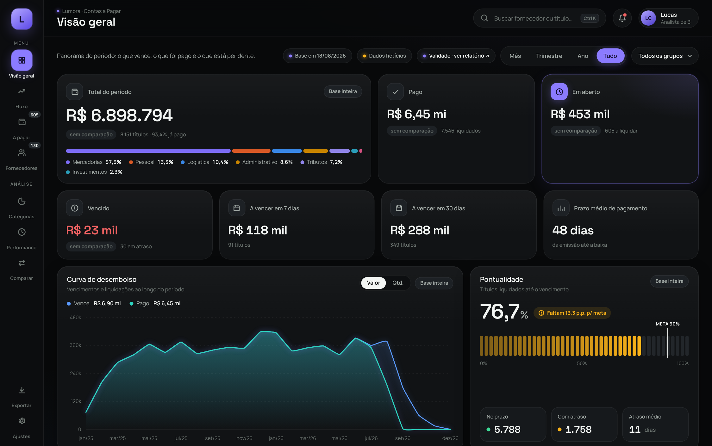

# Contas a pagar: painel interativo

Painel interativo de contas a pagar, com fluxo de caixa, faixas de vencimento, pontualidade, concentração de fornecedores e comparação entre períodos.

**Empresa e dados 100% fictícios.** A "Lumora Distribuidora" não existe. A base foi gerada por um script, com regras de calendário, sazonalidade, prazos e comportamento de pagamento. Os CNPJs têm dígito verificador inválido de propósito.

- 🔗 **Painel:** `index.html`
- ✅ **Relatório de validação:** `validacao.html`



## O que o painel responde

| Página | Pergunta |
|---|---|
| Visão geral | Quanto vence no período, quanto já foi pago e quanto está pendente? |
| Fluxo | Quanto ainda falta desembolsar e quando? |
| A pagar | O que está vencido e o que vence nos próximos dias? |
| Fornecedores | Para quem vai o dinheiro? Quantos fornecedores concentram 80% do gasto? |
| Categorias | Em que o dinheiro é gasto e como isso se distribui no tempo? |
| Performance | Pagamos em dia? Quem acumula mais atraso? |
| Comparar | Como dois períodos quaisquer se comparam, por categoria? |

## Como foi feito

- Uma página HTML única, sem servidor: React, gráficos em SVG e os dados embutidos no próprio arquivo.
- Tabela virtualizada: rola milhares de títulos renderizando só as linhas visíveis.
- Filtros guardados na URL, então os botões voltar/avançar do navegador funcionam.
- Animações nas trocas de filtro (números contando, gráficos se transformando), que respeitam a preferência "reduzir movimento" do sistema.
- Desenvolvido com apoio de IA.

## Como foi validado

Cada número exibido foi **recalculado por fora**, em Python/pandas e direto dos dados brutos, e **comparado com o painel num navegador real**, em **todas as combinações de período e grupo**, com tolerância praticamente nula:

- **Valor exato** (lido de um atributo invisível `data-v`, sem arredondamento): até R$ 0,0001 em valores, 1 bilionésimo relativo em percentuais e zero em contagens.
- **Texto na tela:** idêntico, caractere por caractere, ao valor esperado formatado com as mesmas regras de arredondamento.

| | |
|---|---|
| Números conferidos | **48.463** em 304 cenários: 35 períodos (24 meses, 8 trimestres, 2 anos, base inteira) × 8 opções de grupo = 280 recortes, cada um em todas as páginas e nos 4 filtros da tabela, mais 24 comparações |
| Problemas encontrados | **8**; na versão original do painel, a conferência aponta 1.300 divergências |
| Divergências na versão final | **0** |
| Checagens de integridade dos dados | 16 (12 OK, 3 alertas, 1 limitação) |
| Testes funcionais | 9, todos aprovados |

**Problemas encontrados e corrigidos:**

1. O rodapé da tabela dizia "Total em aberto", mas no filtro "Todos" somava também os títulos já pagos.
2. "Participação no total" calculava o % só sobre os itens visíveis (top 6/8), e grupos contábeis sumiam da lista.
3. Na visão mensal, pagamentos de outros meses entravam na semana de mesmo dia.
4. "Prazo médio" escrevia "1 dias".
5. Totais terminados em ,50 podiam aparecer arredondados para baixo por causa da soma em ponto flutuante.
6. Períodos sem nenhum pagamento (ex.: out–dez/2026) mostravam pontualidade de 0,0% e "Faltam 90 p.p. p/ meta"; agora mostram "—".
7. A rosca de fornecedores mostrava "R$ 1" no centro quando o recorte não tinha títulos.
8. Gráficos sem nenhum valor mostravam eixo "1, 1, 1, 0, 0", e o Pareto dizia "gasto pulverizado" sem nenhum fornecedor.

Os problemas 6 a 8 só apareceram quando a conferência passou a cobrir todas as combinações, inclusive recortes vazios.

Detalhes, regras de negócio e limitações estão em [`validacao.html`](validacao.html).

### Reproduzir

```bash
pip install pandas playwright
playwright install chromium
cd validacao
python reconciliacao.py ../index.html saida_completa/ --completo   # ~8 min · 48.463 conferências
python reconciliacao.py ../index.html saida/       # ~2,5 min · 61 cenários, 4.640 conferências
python testes_funcionais.py ../index.html saida/   # ~5 min · 9 testes
```

Resultados em `validacao/saida_completa/` (cobertura total) e `validacao/saida/` (61 cenários). Cada conferência tem uma linha em `reconciliacao.csv`, com o valor esperado, o valor exato do painel, a diferença, a tolerância, o texto exibido e o texto esperado. As divergências da versão original estão em `validacao/antes_das_correcoes/divergencias.csv`.

## Estrutura

```
index.html                    painel
validacao.html                relatório de validação
img/                          capturas de tela
validacao/
  reconciliacao.py            recálculo independente × tela
  testes_funcionais.py        testes no navegador
  saida_completa/             resultados da cobertura total (280 recortes)
  saida/                      resultados do modo rápido e dos testes funcionais
  antes_das_correcoes/        divergências da versão original
```
